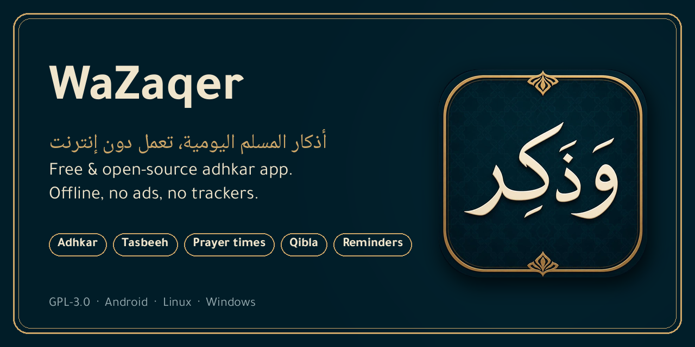

<p align="center">
  
</p>

# WaZaqer (وَذَكِر)

[](https://github.com/software-ace/WaZaqer/actions/workflows/release.yml)
[](LICENSE)
[](https://flutter.dev)
[](#build)
[](#privacy)
[](https://github.com/sponsors/software-ace)

A free and open-source Flutter app for daily adhkar (remembrance): after prayer, morning, evening, and sleep.

تطبيق حر ومفتوح المصدر للأذكار اليومية: أذكار بعد الصلاة، الصباح، المساء، والنوم.

## Features

- **Adhkar**: 135 groups in 11 categories plus «all adhkar», with the source (takhrij) of every dhikr. Favourites, search that ignores tashkeel and alef/hamza variants, and a search scoped to each category.
- **Reader**: one dhikr per page with a tap counter and progress ring. It moves to the next dhikr when the count is reached and resumes where you left off. Share, copy, and keep the screen awake while reading.
- **Tasbeeh**: tap anywhere to count, with 33 / 100 / unlimited targets and a cycle counter.
- **Prayer times**: calculated offline, with 13 methods or automatic selection by region. Highlights the next prayer.
- **Qibla**: a compass from the phone's magnetometer.
- **Reminders**: per-group reminders (morning and evening timed from sunrise and sunset), salawat reminders across the day, and optional adhan notifications. All use the system sound.
- **Settings**: accent colour, light/dark theme, Arabic or Latin digits, tashkeel on/off, six Arabic fonts and font size.

Arabic-first, right-to-left throughout.

## Privacy

No ads, no analytics, no trackers, no accounts, and no `INTERNET` permission. Everything stays on the device. Android permissions:

| Permission | Why |
|---|---|
| Notifications | Reminders and adhan (asked for when you turn them on) |
| Coarse location | Prayer times and qibla (asked for only when you choose "use my location"; you can pick a city instead) |
| Run at startup | Restore scheduled reminders after a reboot |
| Vibration | Vibrating reminders |

Location uses Android's own `LocationManager`, not Google Play Services, so the app builds without proprietary libraries.

## Build

Requires the Flutter version pinned in `pubspec.yaml` (`environment: flutter`).

```sh
flutter pub get
flutter test
flutter build apk --release       # Android (minSdk 24)
flutter build linux --release     # Linux desktop
flutter build windows --release   # Windows desktop
```

or run it directly with `flutter run`. Reminders work on Android only; the desktop builds have no background scheduler.

## Releases

The **Release** workflow (`.github/workflows/release.yml`) runs analyze and tests, then builds split-per-ABI APKs and the Linux and Windows bundles. A push of a tag `vX.Y.Z` publishes a GitHub release; the tag must match `version:` in `pubspec.yaml`. A manual run of the workflow only uploads the builds as artifacts.

Release APKs are signed with one key, from `android/key.properties` locally (gitignored) or from the `ANDROID_KEYSTORE_*` / `ANDROID_KEY_*` repository secrets in CI. Tag builds refuse to fall back to the debug key.

## F-Droid

Fastlane metadata lives in `fastlane/metadata/android/` (English and Arabic), ready to be referenced from an fdroiddata build recipe. The CI build steps mirror that recipe so the APKs are reproducible.

## License

GPL-3.0. See [LICENSE](LICENSE).

## Content attribution

The adhkar texts (`assets/adhkar.json`) are supplications and remembrances
transmitted in the public-domain hadith collections (Sahih al-Bukhari, Sahih
Muslim, Sunan Abi Dawud, Jami` at-Tirmidhi, Sunan an-Nasa'i, Sunan ibn Majah,
Musnad Ahmad and others), cited per dhikr in the `source` field. They are
ancient religious texts with no copyright holder; only their compilation was
taken from public datasets, and the category arrangement is this project's own.

The bundled Arabic fonts are under the SIL Open Font License, each with its
license text in `assets/fonts/OFL-*.txt`: Amiri, Scheherazade New, Noto Naskh
Arabic, Cairo, Reem Kufi and Tajawal (source: google/fonts).

Prayer times use the standard astronomical method published by praytimes.org;
the calculation in `lib/prayer.dart` is this project's own implementation.
